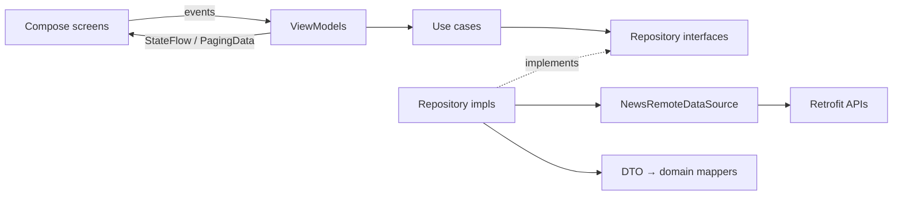
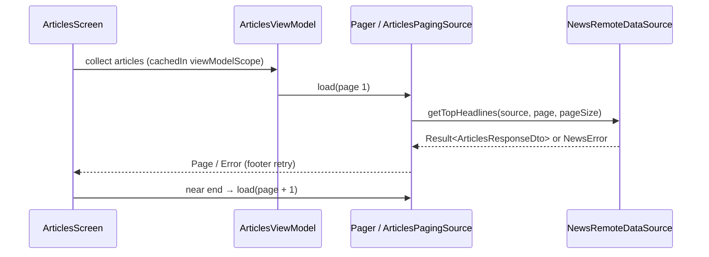

# NewsScope

*See Beyond the Headlines.* NewsScope is a native Android news reader built on [NewsAPI](https://newsapi.org/docs), with an editorial look (serif headlines, restrained palette) in light and dark themes.

Package `com.yasha.newsscope` · Kotlin · Jetpack Compose · Min SDK 26 (Android 8.0)

## Features

| Area | What it does |
|---|---|
| **Splash** | AndroidX SplashScreen (system) followed by a short animated Compose brand screen on the same navy background. No artificial loading delay. |
| **Home** | Header with theme toggle and search, live "Top stories" (real `/top-headlines` data, nothing fabricated), horizontally scrolling category chips with selected/unselected states, and a Discover card leading to the selected category. |
| **Categories** | Business, Entertainment, General, Health, Science, Sports, Technology, each with its own icon. Also listed on the Discover tab. |
| **Sources** | `/top-headlines/sources` by category: name, description, category, country, host. Case-insensitive search, endless scrolling (client-side), skeletons, empty/error states. |
| **Articles** | `/top-headlines?sources=` with **Paging 3** server-side pagination, thumbnail, headline, description, relative date, source. De-duplication, end-of-list marker, independent append errors with retry. |
| **Article reader** | In-app `WebView` with progress bar, back navigation, error screen with retry, http→https upgrade, non-web schemes blocked, SSL errors never bypassed, lifecycle-aware (pause/resume/destroy). |
| **Search** | *Articles*: `/everything` with 400 ms debounce, pagination that resets on every new query, optional scoping to one source. *Sources*: local filtering. Blank queries never hit the network. |

## Screenshots

Add screenshots to `docs/screenshots/` and link them here (splash, home, sources, articles, reader, search, dark theme).

## Technology stack

Kotlin 2.2 · Compose + Material 3 · Navigation Compose (type-safe routes) · Hilt · Retrofit 3 + OkHttp 4 · kotlinx.serialization · Coroutines/StateFlow · Paging 3 · Coil 3 · AndroidX SplashScreen · JUnit, MockK, Turbine, coroutines-test, MockWebServer, paging-testing. Versions live in `gradle/libs.versions.toml` (AGP 9.4.1, Gradle 9.6).

Fonts: Playfair Display (headlines) and Inter (UI), both SIL OFL, bundled in `res/font`.

## Architecture

Clean Architecture + MVVM with unidirectional data flow: UI renders immutable state exposed as `StateFlow`/`PagingData` and sends events to the ViewModel.



Dependency rule: `presentation → domain ← data`. Domain has no Android or Retrofit dependency; DTOs never leave `data`.



### Package structure

```
com.yasha.newsscope
├── core/          common (UiState), designsystem (theme, type, spacing), error (NewsError),
│                  navigation (routes), network (API key interceptor/provider), util (UrlSafety)
├── data/          remote/{api, dto, datasource}, mapper, repository
├── domain/        model, repository (interfaces), usecase
├── presentation/  splash, home, category, sources, articles, search, webview, components
├── di/            NetworkModule, RepositoryModule
└── MainActivity.kt, ThemeViewModel.kt, NewsScopeApplication.kt
```

### Key decisions

- **Sources pagination is client-side.** The sources endpoint returns the whole list. `SourceListState` fetches once, then `GetSourcePageUseCase` *filters first, then paginates*, so "has more" always reflects the filtered total and a new query resets to the first page.
- **Articles use Paging 3.** `ArticlesPagingSource` uses 1-based pages, `initialLoadSize == pageSize` (keeps page numbers aligned), ends pagination on `totalResults`, a short page or an empty page, and drops URLs it has already emitted. Exhaustion uses the *raw* fetched count so discarded `[Removed]` items cannot end paging early.
- **Errors are typed.** `NewsError` covers no connection, timeout, missing key, 401, 426, 429, 5xx, other HTTP, invalid response and unknown. Responses with `status: "error"` inside a 200 body are translated too. Only retryable errors show a retry button.
- **Nullable API data.** Every DTO field is nullable; mappers drop articles with no title/URL or the `[Removed]` placeholder, strip HTML from titles/descriptions, and tolerate missing image, description, author, source and date.

## API integration

| Endpoint | Used for | Parameters |
|---|---|---|
| `GET /v2/top-headlines/sources` | Sources screen, Sources search tab | `category`, `language`, `country` |
| `GET /v2/top-headlines` | Article list, home featured section | `sources`, `country`, `category`, `page`, `pageSize` |
| `GET /v2/everything` | Article search | `q`, `sources`, `sortBy`, `page`, `pageSize` |

The key is sent in the `X-Api-Key` header by an OkHttp interceptor (never in the URL). Debug logging is `BASIC` level with the key header redacted. Timeouts are 20 s.

## Setup

1. Install Android Studio with JDK 17+ and Android SDK 37.
2. Get a free key at <https://newsapi.org/register>.
3. Copy `secrets.properties.example` to `secrets.properties` in the project root and set:
   ```
   NEWS_API_KEY=your_key_here
   ```
   `secrets.properties` is git-ignored. Without a key the app starts and shows a clear "API key is missing" state.
4. Run `./gradlew :app:installDebug`, or press Run in Android Studio.

> **Security note:** an API key compiled into an APK can be extracted and cannot be considered a production secret. For a real deployment, route requests through a backend proxy that holds the key.

## Testing

```
./gradlew :app:testDebugUnitTest
```

72 unit tests (no device needed):

- **Domain:** use cases (success, failure, blank query, filtering + paging), category list.
- **Data:** DTO→domain mapping with null fields and markup; `NewsRemoteDataSource` against a real Retrofit/OkHttp stack on `MockWebServer` covering success, request parameters and key header, **401, 426, 429, 500**, unexpected status, malformed JSON, empty response, `status:error` bodies, **timeout**, **no connection**, **missing API key**, and recovery after retry; repositories; `ArticlesPagingSource` (first page, next page, exhaustion, de-duplication, error then retry).
- **Presentation:** ViewModels with Turbine / coroutines-test: initial loading, content, empty, error, retry (including no duplicate requests), query changes, debounce, pagination reset, source-scoped search.
- **Util:** `UrlSafety` (invalid URLs, non-web schemes, http upgrade).

Compose UI and instrumented WebView tests are not included.

## Known API limitations

- The sources endpoint has no pagination (handled client-side) and returns about 130 sources in total.
- NewsAPI's free Developer plan limits results to the first 100 per query and serves articles with up to ~24 h delay; going past the window returns HTTP 426 / `maximumResultsReached`, which the app reports as a non-retryable "limit reached" message in the list footer.
- Some sources return stale or `[Removed]` articles and HTML in descriptions; the app filters and cleans what it can.
- The Developer plan is intended for development and is not licensed for production use.
- `/top-headlines` cannot combine `sources` with `country` or `category`; the app never does.

## Future improvements

- Persist theme choice and recent searches (DataStore).
- Offline cache (Room + `RemoteMediator`) for articles.
- Backend proxy for the API key.
- Bookmarks and share action; language/country filters for sources.
- Compose UI tests and screenshot tests; baseline profile.
